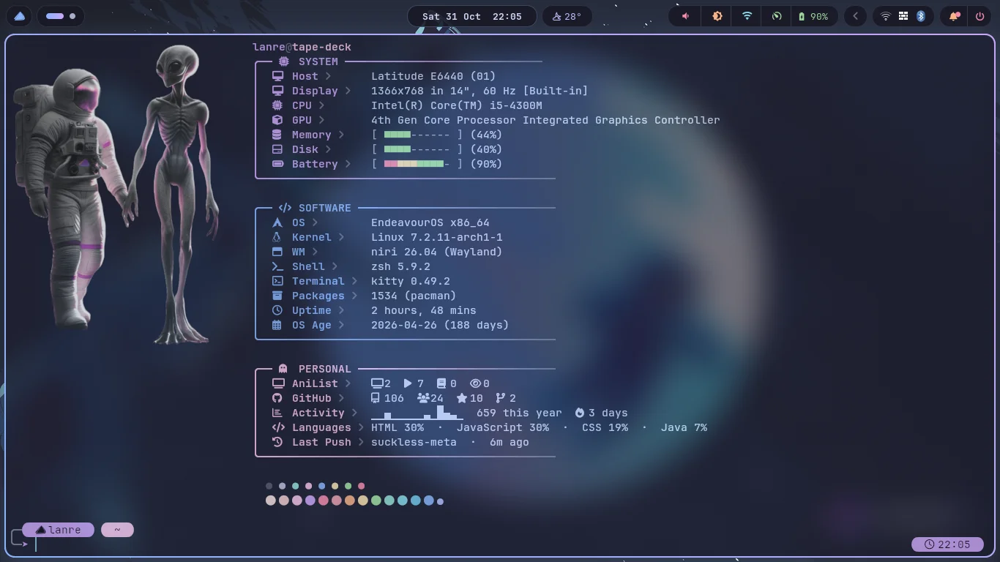
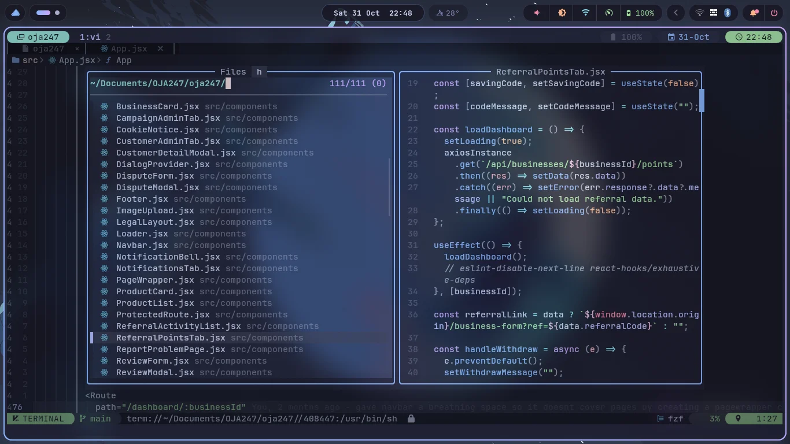
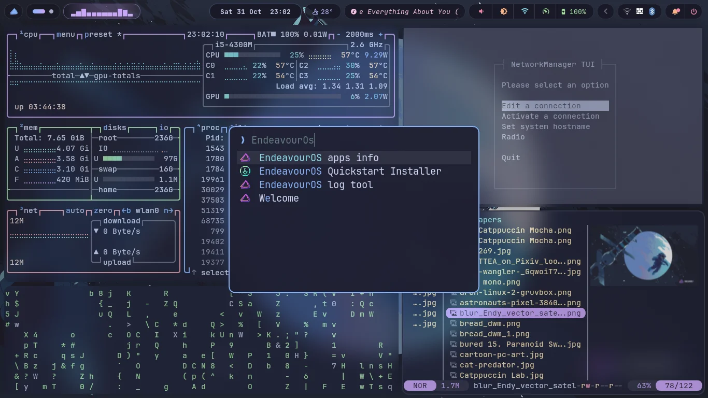
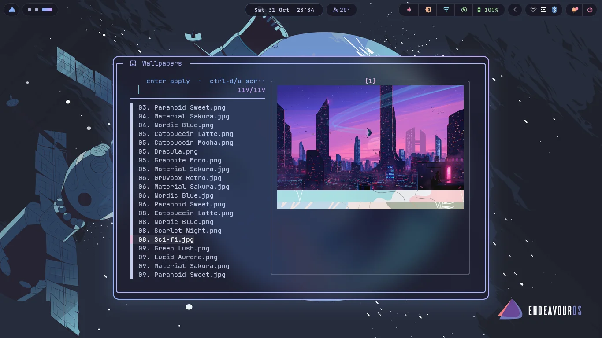

# Linux dotfiles

A personal Linux workstation, configured with **GNU Stow**. This repository brings together desktop, terminal, and development configs, with an installer designed to link them without overwriting existing files.

[](https://github.com/lanre647/my_dotfiles/actions/workflows/dotfiles.yml)
[](https://www.gnu.org/software/stow/)
[](./LICENSE)

## The setup

### Workspace



Niri on Wayland, with Waybar, zsh, Kitty, and Starship. The current color palette is Catppuccin Mocha.

### Development



Neovim with a Lua configuration, Fzf-lua, Treesitter, Mason, and native LSP.

### Utilities



The CLI toolkit includes btop, yazi, Fuzzel, Fastfetch, nmtui, unimatrix, and cava.

### Notifications


### Wallpaper picker



## Install

### Bootstrap

Requires Bash, Git, and an internet connection. The bootstrap script clones the repository to `~/.dotfiles`, initializes submodules, installs missing base tools without prompting, then links the configs.

```bash
bash <(curl -fsSL https://raw.githubusercontent.com/lanre647/my_dotfiles/main/bootstrap.sh)
```

### Review before installing

Clone locally to inspect the proposed links before applying them:

```bash
git clone --recurse-submodules https://github.com/lanre647/my_dotfiles.git ~/.dotfiles
cd ~/.dotfiles
./install.sh --dry-run
./install.sh
```

The installer asks before installing missing base tools when run interactively. Use `--yes` to install without prompting or `--no-packages` to skip package installation. Supported package managers are apt, pacman, dnf, Homebrew, and Termux `pkg`. If your system uses a different package manager, install GNU Stow, Git, tmux, zsh, and Vim yourself.

## Choose what to link

By default, the installer links every available package, including desktop-specific configs. Select only the packages you need:

```bash
./install.sh --package nvim --package git --no-packages
./install.sh --list
./install.sh --target "$HOME/test-dotfiles" --dry-run
```

Available packages:

| Area | Packages |
| --- | --- |
| Desktop | `clipmenu`, `dunst`, `fuzzel`, `kitty`, `mako`, `niri`, `picom`, `swaylock`, `waybar`, `x11` |
| Terminal and tools | `bin`, `fastfetch`, `git`, `lazygit`, `scripts`, `starship`, `tmux`, `vim`, `zsh` |
| Development | `nvim` |

GNU Stow checks for conflicts. If a target file already exists and is not one of these dotfiles' links, Stow reports the conflict and leaves the file untouched. Back up or move the conflicting file yourself, then rerun the installer. Re-running updates existing links.

## What gets linked

- Most packages map their contents into `$HOME`; for example, `nvim/.config/nvim` becomes `~/.config/nvim`.
- The `bin` package provides commands under `~/.local/bin`; `scripts` is linked into `~/bin`.
- `.config` remains a normal directory. Stow runs with `--no-folding`, so unrelated files under it are not hidden by a directory symlink.
- Tmux Plugin Manager is included as a Git submodule. The tmux config can install TPM and plugins on first launch; plugin downloads require an internet connection.

## Requirements and optional applications

The installer handles the base tools needed by the configs: GNU Stow, Git, tmux, zsh, and Vim. It does not install desktop environments or configuration-specific applications. Programs such as Niri, Kitty, Fuzzel, Waybar, and wallpaper utilities must be installed separately with your system's package manager.

Zsh works without Oh My Zsh. Starship, zoxide, fzf, fnm, eza, and custom Oh My Zsh plugins are optional and initialized only when available. Some aliases and desktop keybindings still depend on their corresponding applications.

## Uninstall

From the repository root, remove links for selected packages with Stow:

```bash
stow --dir="$PWD" --target="$HOME" --delete nvim git
stow --dir="$PWD" --target="$HOME/bin" --delete scripts
```

This removes links only; it does not uninstall applications or delete user data.

## Repository layout

Each package listed by `./install.sh --list` contains the files Stow links into the target directory. The `scripts` package uses a separate target (`~/bin`); `pkgs/` contains package lists and is not linked.

## License

[MIT](./LICENSE)
